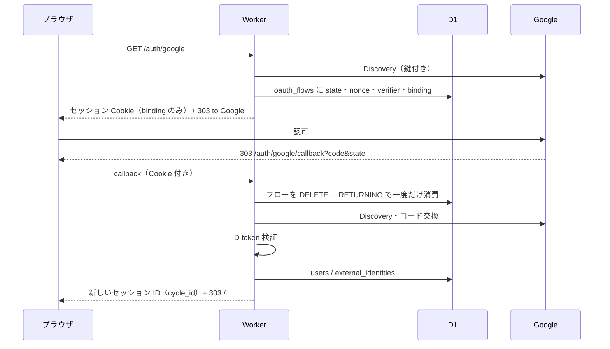

# Google ログイン（Issue #52 / #53〜#58）

認証は Google の OpenID Connect（認可コード + PKCE）、セッションは `tower-sessions` 0.14 と D1、利用者は Google が保証する `(iss, sub)` で識別する。メールアドレスは本人識別に使わない。

## 構成



| 層 | 役割 | ファイル |
|---|---|---|
| OIDC | Discovery、コード交換、ID token 検証、Workers の fetch | `src/oidc.rs` |
| 保存 | 利用者・外部 ID・フロー・期限切れ削除 | `src/auth_store.rs`、`migrations/0002_auth.sql` |
| セッション | D1 の `SessionStore`、サーバー側の認証状態 | `src/session_store.rs`、`src/session_state.rs` |
| ルート | ログイン画面・開始・callback・ログアウト・`Member` | `src/auth.rs` |

## Google Cloud の設定（利用者が行う）

1. Google Cloud コンソールでプロジェクトを選び、「Google Auth Platform」で同意画面を設定する。利用者の種類、アプリ名、サポートメールを入力する。公開状態が「テスト」の間は、テストユーザーに追加したアカウントだけがログインできる。
2. 「クライアント」から OAuth クライアント ID を作る。種類は「ウェブ アプリケーション」。
3. 承認済みのリダイレクト URI に、固定の callback URL だけを登録する。
   - 本番: `https://<本番ホスト>/auth/google/callback`
   - ローカル: `http://localhost:8787/auth/google/callback`
   ワイルドカードや他のパスは登録しない。Worker は callback URL を設定値から使い、`Host` ヘッダーから組み立てない。
4. スコープは `openid` だけを要求する。メールやプロフィールは取得しない。
5. 発行された ID とシークレットを次の名前で登録する。値をコミット、ログ、Issue に書かない。

| 名前 | 本番 | ローカル | 種別 |
|---|---|---|---|
| `GOOGLE_CLIENT_ID` | GitHub Secret（デプロイが Worker の var にする） | `.dev.vars` | var |
| `GOOGLE_CLIENT_SECRET` | GitHub Secret（Worker の secret にする） | `.dev.vars` | secret |
| `GOOGLE_REDIRECT_URL` | GitHub Secret（var）。`https://…/auth/google/callback` | `.dev.vars`（`http://localhost:8787/auth/google/callback` を許す） | var |

### 登録手順

登録先は GitHub Secrets だけでよい。Cloudflare 側の値は、main へのデプロイ時に `cloudflare/wrangler-action` が GitHub Secrets から Worker へ渡す（`GOOGLE_CLIENT_ID`・`GOOGLE_REDIRECT_URL` は var、`GOOGLE_CLIENT_SECRET` は secret）。Cloudflare のダッシュボードや `wrangler secret put` で同じ名前を手で作る必要はない。`CLOUDFLARE_API_TOKEN`・`CLOUDFLARE_ACCOUNT_ID`・`D1_DATABASE_ID` は既存のものを使う。

```sh
# リポジトリで gh auth login 済みであること。--body に値を書く2つは秘密ではない。
gh secret set GOOGLE_CLIENT_ID --body 'xxxx.apps.googleusercontent.com'
gh secret set GOOGLE_REDIRECT_URL --body 'https://<本番ホスト>/auth/google/callback'
# シークレットはシェルの履歴に残さないよう、引数でなく対話入力（貼り付けて Enter、Ctrl+D）で渡す。
gh secret set GOOGLE_CLIENT_SECRET
gh secret list   # 3つの名前が並ぶことを確認する（値は読み戻せない）
```

GitHub の画面なら、リポジトリの Settings → Secrets and variables → Actions → New repository secret で同じ3つを登録する。`<本番ホスト>` は Worker の公開ホスト名で、Google Cloud に登録した承認済みリダイレクト URI と一字一句一致させる。

ローカル（`wrangler dev`）は、`.dev.vars`（gitignore 済み）に書く。

```
GOOGLE_CLIENT_ID=xxxx.apps.googleusercontent.com
GOOGLE_CLIENT_SECRET=…
GOOGLE_REDIRECT_URL=http://localhost:8787/auth/google/callback
```

ローカル用のリダイレクト URI も Google Cloud に登録しておく。Safari は HTTP の localhost で Secure Cookie を保持しないため、Safari で確認するときは信頼済み証明書の HTTPS 環境を使う。

Cloudflare へ手動で入れる場合（通常は不要）は、`npx wrangler secret put GOOGLE_CLIENT_SECRET`。var 2つは `wrangler.toml` に書かず、デプロイ時の `--var` で渡す運用に合わせる。

登録後の確認: ① main へ merge（または CI の `deploy` ジョブ）が「Require notification and authentication settings」を通る。② デプロイ後に `/login` が表示され、リンクから Google の画面へ移る。未設定のままだと Worker は全リクエストに503を返す。値を変えたときは再デプロイが必要。旧 `AUTH_SECRET`・`AUTH_PASSWORD` は `gh secret delete AUTH_SECRET`／`gh secret delete AUTH_PASSWORD` で削除でき、Worker 側の同名 secret は `npx wrangler secret delete AUTH_SECRET`／`AUTH_PASSWORD` で消せる。

どれかが未設定、またはリダイレクト URL が `https://`（ローカルは `http://localhost`）以外の場合、Worker は全リクエストに503を返す。デプロイは3つの値の存在と URL の形式を確認してから進む。旧 `AUTH_SECRET`・`AUTH_PASSWORD` は不要になったので、GitHub Secrets と Worker の secret から削除してよい。

## ID token の検証（#53）

| 検証 | 担当 |
|---|---|
| 署名（RS256 のみ許可） | `openidconnect`。他のアルゴリズムは拒否 |
| `iss` が `https://accounts.google.com` | `openidconnect` と `verify` の二重 |
| `aud` が自分のクライアント ID | `openidconnect`（追加の audience は拒否） |
| `exp`（時計は `now` 引数。Workers の `Date`） | `openidconnect` |
| `nonce` | `openidconnect`（フローに保存した値） |
| `azp` が自分のクライアント ID。`azp` が無いときは `aud` が1つ | `src/oidc.rs` の `verify`。クレートは検証しない |
| `sub` が空でなく255文字以内 | `verify` |

外部への通信は `Fetch` だけが行い、HTTPS・既定ポート・`accounts.google.com`／`oauth2.googleapis.com`／`www.googleapis.com` のみを許す。redirect は追わず（3xx は失敗）、応答は256 KiB までで、Discovery の認可エンドポイントが Google のホスト以外なら拒否する。エラーには token・コード・応答本文を含めない。

**公開鍵の方針**: Discovery は `jwks_uri` の鍵も取得する。ログインのたびに Discovery をやり直し、鍵をリクエストをまたいでキャッシュしない。ログインは利用者あたり1日に数回以下なので、追加の通信（Discovery、JWKS、トークン）は許容でき、鍵更新後の次のログインから新しい鍵で検証される。Google が鍵を失効させれば、次のログインから信頼されない。キャッシュを導入する場合は、未知の `kid` で1回だけ再取得する設計にする。

## セッション・失効（#55）

- Cookie は `__Host-session`（HttpOnly・Secure・SameSite=Lax・Path=/、Domain なし）で、ランダムな128ビットのセッション ID だけを持つ。Google の token と PKCE verifier は Cookie にもセッションにも入れない（verifier は `oauth_flows`、削除前提の短期保存）。
- D1 の `sessions` はセッション ID の SHA-256 をキーにする。表のコピーからは Cookie の値を復元できない。
- ログイン前（フロー用）は15分の無操作で期限切れ。ログイン成功時に `cycle_id()` で ID を変え、サインイン後の有効期限は**絶対 24 時間**（操作では延びない）。ログアウトは `flush()` で D1 の記録を消し Cookie を消す。
- サーバー側の認証状態（セッション内の `identity`）: 利用者 ID、`session_version`、認証強度（`Google`／`Additional`）、終了時刻 `expires_at`。`tower-sessions` はリクエストごとの設定から有効期限を計算し直して保存するため、24時間の上限は `expires_at` を読み出し時に検証して守る。ログイン用ルートがログイン済みセッションを書き換えるときは、`pin_expiry` で保存される期限も固定する。`Additional` への昇格は `session_state::promote` だけが行い、ブラウザの値では変わらない（Passkey は今回未実装）。
- すべてのリクエストで `users` を引き、`status = 'active'` かつ `session_version` が一致しなければ未認証として扱う。

運用操作（`wrangler d1 execute app --remote --command "…"`）:

| 操作 | SQL |
|---|---|
| 利用者を無効化 | `UPDATE users SET status='disabled' WHERE id='…'` |
| 利用者の全セッションを失効 | `UPDATE users SET session_version=session_version+1 WHERE id='…'` |
| 全員を失効 | `DELETE FROM sessions` |
| 期限切れの掃除 | cron（毎分）とログイン開始時に自動実行 |

## D1 migration と切り戻し

| ファイル | 内容 | 切り戻し |
|---|---|---|
| `migrations/0002_auth.sql` | `users`・`external_identities`・`sessions`・`oauth_flows` | `migrations/rollback/0002_auth_down.sql` |
| `migrations/0003_owner_isolation.sql` | 利用者別の `push_probe`・`counters`、配信の所有者トリガー、移行記録 | `migrations/rollback/0003_owner_isolation_down.sql` |
| `migrations/0004_flow_limit.sql` | `oauth_flows.client`（接続元のハッシュ）と索引 | `migrations/rollback/0004_flow_limit_down.sql` |

`wrangler d1 migrations apply` は前進のみ。切り戻しファイルは `wrangler d1 execute --file` で手動実行する。0004、0003、0002 の順に実行する（`legacy_owner_migration` が `users` を参照するため）。その前に旧版の Worker に戻しておく（新版の Worker は新テーブルを前提にする）。0001 の既存の服薬・購読データには触れない。単一所有者データの引き継ぎと切り戻しは [data-isolation.md](data-isolation.md)。

デプロイの順序: ① GitHub Secrets を3つ登録 → ② Google Cloud の redirect URI を登録 → ③ merge（CI が migration → Worker の順に適用）→ ④ 移行先の利用者が一度ログイン → ⑤ `scripts/legacy-owner.sh` で既存データを引き継ぐ。④⑤の前でも新規利用者は使えるが、旧データは `owner='owner'` のまま誰からも見えない。

## 利用者が確認する項目（未実施）

自動テストでは実際の Google ログインを実行できない。次は利用者の環境で確認し、結果を PR に記録する。

- [ ] 実際のブラウザで「Google でログイン」のリンクを押し、Google の画面へ遷移すること（HTML 上は `<a href="/auth/google">` のみで、hypersig のランタイムが介入しないことはソースで確認済みだが、ブラウザでの操作は未実施）。
- [ ] HTTPS の環境（本番、または信頼済み証明書のローカル）で、2つの Google アカウントの初回ログインと再ログイン。
- [ ] 2アカウントのデータ分離（片方が作った服薬が他方に見えない）、ログアウト、旧 Cookie（`__Host-medication`）での拒否。
- [ ] Safari とホーム画面に追加した PWA でのログインと再読み込み後の維持。Safari の HTTP localhost は Secure Cookie を保持しない。
- [ ] 同意画面でキャンセルしたときのログイン画面の表示。
- [ ] 利用者の無効化・`session_version` 加算で、開いているタブの次の操作が401になること。
- [ ] 本番の Google 側の鍵更新直後のログイン（頻度が低く、再現できない）。

## 自動検証（実施済み）

| 検証 | コマンド | 内容 |
|---|---|---|
| Rust | `cargo fmt --check`、`cargo clippy --all-targets -- -D warnings`、`cargo test` | OIDC の検証（不正な署名・iss・aud・nonce・azp・期限・アルゴリズム・鍵更新）、固定ホスト制限、セッション状態、`Member`・リダイレクト／401 |
| wasm | `cargo check --target wasm32-unknown-unknown` | |
| SQL | `python3 scripts/test-persistence.py` | migration の適用・切り戻し、フローの一度きりの消費、別接続からの重複した初回ログイン（条件付き INSERT と一意制約）、所有者分離、引き継ぎ・切り戻し。並行実行そのものの保証は、D1 が batch を直列に実行することに依る |
| Worker | `scripts/test-worker.py`（`wrangler dev` に対して） | 実際の workerd 上で、Google の Discovery への到達、ログイン開始の redirect と Cookie 属性、callback の不正入力・再利用、シード済みセッションでの2利用者の分離・失効・ログアウト |
| ビルド | `sh scripts/build.sh` | `worker-build --release` |

`scripts/test-worker.py` は Google アカウントを使わない。`scripts/auth_fixture.py` がローカル D1 に利用者とセッションの行を直接書く。本番コードにテスト用のログイン経路はない。

最小依存での `cargo check` の結果と、Workers 上の実行結果は区別して扱う。Workers 上では、Google の Discovery（鍵取得を含む）の実通信とトークンエンドポイントへの到達（偽のクライアント設定と偽のコードでの交換が拒否され、`auth: Exchange` の分類でログイン画面に戻る）まで確認した。拒否の理由コードは確認していない。正規のコードによる交換と ID token の検証は、上の「確認する項目」のとおり実際のログインでのみ確認できる。

## 制約と未対応

- 登録は開放されている。Google アカウントを持つ人は誰でも利用者を作れる（同意画面を「テスト」にしてテストユーザーに限定するか、必要なら許可リストを導入する）。
- 未認証の `/auth/google` は、接続元（`cf-connecting-ip` のハッシュ。IPv6 は /64）ごとに未消費のフローを10件までしか作れない。超えると 429（`Retry-After: 600`）を返し、D1 の行は作らない。フローの期限は10分で、期限切れは cron とログイン開始時に消える。Cloudflare のレート制限（WAF）は別に設定できるが、このアプリの上限はそれに依存しない。
- 開始していないブラウザからの callback は、セッションの行を作らない。このため、ログイン画面の案内文は出ない。
- Passkey は未実装。`Level::Additional` と `promote` は将来の追加認証の足場。
