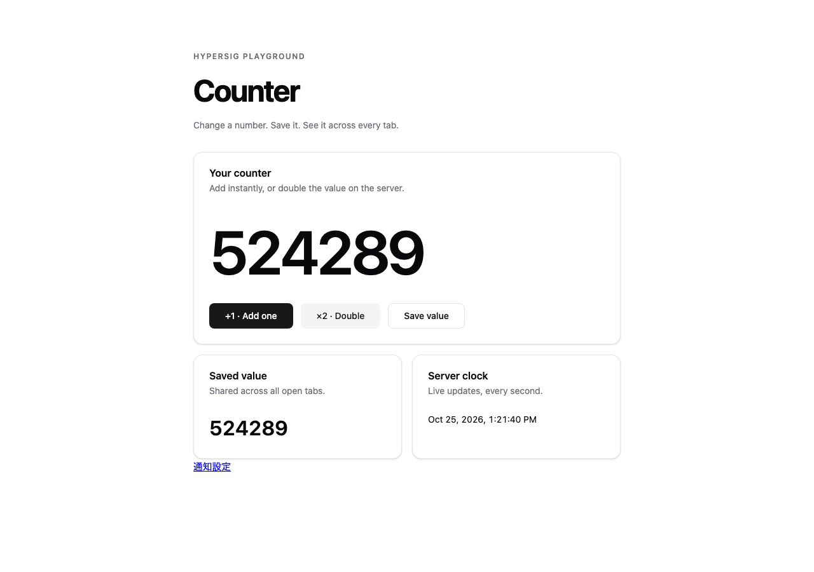
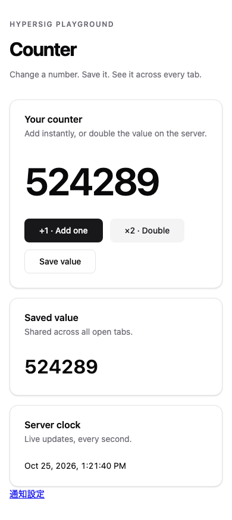

# 服薬ドメインと入力・時刻の契約

Issue #3 の子Issue #12〜#15 の共通実装。永続化・CRUD・ページ・Cron配信への接続は後続工程で行う。

## 入力値

- 日付は西暦0001〜9999の `YYYY-MM-DD`、時刻は24時間制 `HH:mm`。空白や桁省略を受け付けない。
- 量はASCII数字の整数部分1〜4桁、任意の小数部分1〜2桁。正の0.01〜1000に限定し、100倍した整数を保持する。符号・指数・空白・小数点のみは拒否する。表示は小数2桁に正規化する（`0.5` → `0.50`）。先頭ゼロは許容する。
- IDは1〜128文字の英数字・ハイフン・アンダースコア。ブラウザへ渡すときは `to_string()` を使い、大きな数値IDも数値へ変換しない。
- 薬名は空白のみ不可・100文字以内、単位は空白のみ不可・20文字以内、メモは200文字以内。長さはUnicodeスカラー値数。
- 曜日集合は月曜bit 0〜日曜bit 6の非空集合。N日間隔は正の整数。
- timingのDTO値は `unspecified` / `before_meal` / `after_meal` / `between_meals` / `bedtime` / `other`。説明から時刻は推定しない。

`MedicationInput`、`DoseSlotInput`、`PauseInput` の `parse` は最初に `Form::validate` で共有の式ルールを検証する。その後、暦日・時刻・小数量・期間の順序・列挙値をサーバーで厳密に変換する。各失敗は対応する型付きフィールドの `FieldErrors` になり、ページの `Form` signalの `.reject(&errors)` に渡せる。

共有ルールは必須・長さ・繰り返し種別・N>=1・曜日集合を扱う。存在しない暦日、量の精度・範囲、逆転期間、休薬重複はサーバー専用。Rustの任意関数をクライアントで実行する仕組みではない。

休薬の `parse(others)` には、repositoryが同じ薬の既存休薬（編集中の行を除く）を渡す。端点が一致する期間も重複として拒否する。読み取りと保存の競合防止はCRUD/repository側の責務。

## 予定問い合わせ

`Medication::on_date` が毎日・曜日・開始日基準のN日間隔・開始/終了・無効化・休薬の共通判定を行う。開始/終了と休薬は両端を含む。複数枠を時刻順に返し、量・単位・タイミングはslot IDで元の枠に対応する。

- `next(now)` は現在時刻と保存時刻の両方以降で最初の予定を返す。無効・終了・今後の予定なしは別の状態。対応暦は9999-12-31まで。次の該当日を繰り返し条件から直接計算し、休薬中は終了日の翌日へ進む。日数に比例した探索をしない。
- `due(now)` は予定時刻から15分以内（端点を含む）の候補。保存前の予定を除外する。現在日が休薬なら前日分の遅延候補も返さない。配信の重複防止・revision検査は通知repository側で行う。
- 今日の一覧は過去の枠も含む。登録直後の遡及通知の抑止は `due` と `next` に適用する。

すべての時計は引数で渡す。端末時計やSSEの接続を予定判定に使わない。

## 時刻の境界

`LocalDate` / `LocalTime` はAsia/Tokyoの暦日・分単位時刻。`UtcInstant` はUnixミリ秒。`LocalDate::at` でUTCへ変換し、DBが秒を採用する場合はrepository境界で単位を明示して変換する。

`schedule_view::query(medication, Timestamp)` は同じ時計で今日と次回を返し、ID文字列・JST日付文字列・ `Timestamp::from_millis` に変換する。表示は `DATE_TIME`（日本語、UTC+540分）と `TIMEZONE_LABEL` を使用する。`Timestamp::as_millis` はミリ秒のまま扱う。JST 00:00は前日UTC 15:00に相当する。将来のDST対応にはこの固定オフセットを転用しない。

## 検証範囲

単体テストで厳密な変換、閏日・月末・年末、曜日、休薬両端・再開、2日間隔の基準維持、複数枠、保存前の抑止、15分期限、JST/UTC境界、共有ルールとサーバー検証のフィールドエラーを確認する。

追加テストでは、Gregorian暦400年（146,097日）のparse/表示・JST/UTC往復、休薬の00:00〜23:59での全枠抑止、曜日指定の再開と終了日、保存時刻と通知時刻の一致、未来候補の除外、時計の範囲外、Unicode文字数上限、欄ごとの不正値エラー、大きなIDと次回表示用UTCミリ秒を確認する。

この変更はページ・binding・実配信を追加しない。服薬画面と実機通知は後続の接続時に検証する。前提Issue #11の閉じたPWAへの実機受信は引き続き未検証であり、この実装をもって #2/#11 の完了とはしない。

### 既存画面の起動確認

PR #50のローカルビルドを `wrangler dev --local` で起動し、Playwright Chromiumで既存Counter画面を撮影した。服薬画面のスクリーンショットではない。画像は1280×900と390×844のviewportでの全ページ撮影で、モバイル画像は実機ではなく幅の確認。

